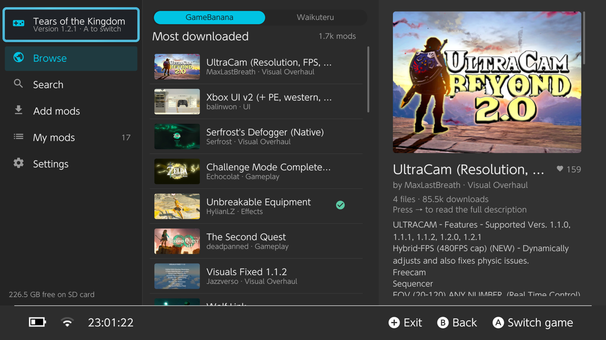
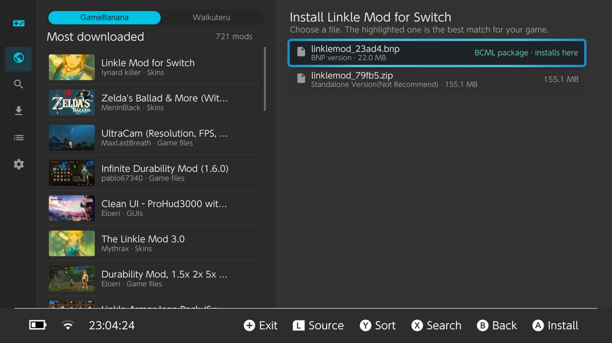
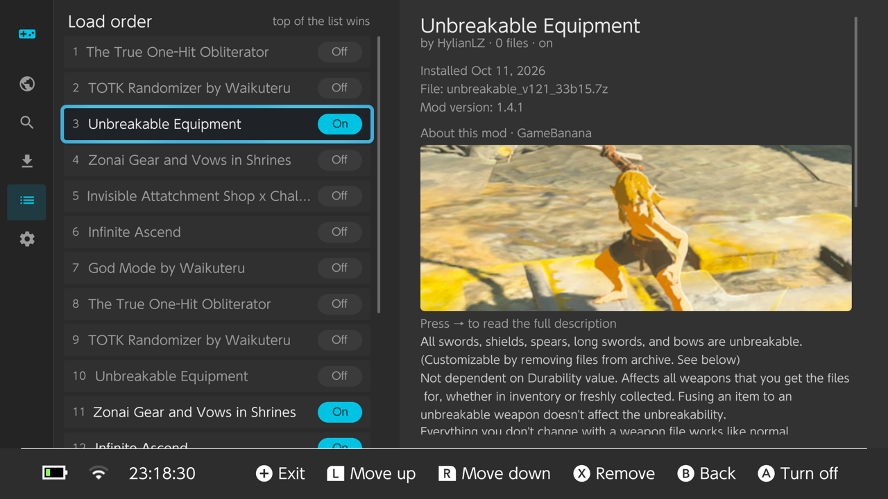

<p align="center"></p>

# Patchwork

A mod manager that runs on your modded Switch. Browse mods for *The Legend of Zelda: Breath of the Wild*
and *Tears of the Kingdom* on [GameBanana](https://gamebanana.com), then download, install, turn on/off,
reorder and remove them, all from the console. No PC needed, including for most BCML packages.

<p align="center">
  
  
  
</p>

Patchwork is an unofficial fan project. It isn't affiliated with or endorsed by Nintendo, GameBanana or
Waikuteru. *The Legend of Zelda* is a trademark of Nintendo. Mods belong to their authors.

## ⚠️ Warnings

Read these before using Patchwork:

- **Use at your own risk.** Patchwork is free software with no warranty (see the [license](LICENSE)). Mods
  change how your games run; a bad or incompatible mod can crash the game or make it fail to start.
- **Back up your saves and your SD card.** Mods can damage save files, and installing a save file from
  GameBanana replaces the save in the slot you pick. Patchwork backs up a profile's saves before installing
  a save file, but keep your own backup too (for example with JKSV or Checkpoint).
- **Going online with custom firmware can get your console banned by Nintendo.** Patchwork only talks to
  GameBanana and Waikuteru's site, but running homebrew and mods while connected to Nintendo's servers is
  risky. Many people use an emuMMC (emuNAND) and block Nintendo's servers (for example with 90DNS) while
  modding. Don't play online with mods.
- **BCML merging on the console is new.** It's been tested with packages of every common kind, but not
  with every package or combination. If the game won't start after installing a BCML package, turn it off
  in My mods; turning packages off and removing them puts the game's files back.
- **Game updates can break mods.** Mods are made for specific game versions; Patchwork warns when a file
  names a different version, but can't always tell. After updating Breath of the Wild, open Patchwork once
  with L and R held so BCML packages are merged with the new files.
- **Background add-ons** (Settings) turn Atmosphère sysmodules on and off. Only change ones you know; some
  homebrew depends on them.
- Mods are downloaded from GameBanana and Waikuteru and belong to their authors. Patchwork doesn't check
  what a mod does; only install mods you trust.

## Features

- **Browse and search** GameBanana with a live preview of each mod, and see an installed mod's page again in My mods
- **Waikuteru's mods** ([waikuteru-zelda-mods.com](https://www.waikuteru-zelda-mods.com)) as a second source in Browse (L/R); only Switch versions are offered
- **Add mods from anywhere**: copy archives into `switch/patchwork/inbox` on the SD card, send a link from your phone (scan the QR code the Switch shows and paste a link), or type a GameBanana mod number (the end of its link, e.g. `724536`) in Add mods or Search
- **Picks the right file** for your installed game version and warns about mismatches
- **One-press install** from zip, 7z and rar, including archives with several options or nested archives
- **On/off without deleting**: a clean copy of every mod is kept, so turning one off restores the files underneath
- **Load order**: when two mods change the same file, the one higher in the list wins, and Patchwork tells you which files clash (files a BCML merge combines aren't clashes)
- **Keeps your own files safe**: anything already in `atmosphere/contents` is backed up before a mod overwrites it and restored afterwards
- **BCML packages (`.bnp`) for Breath of the Wild are merged on the console**, like BCML does on a PC ([below](#bcml-packages-breath-of-the-wild))
- **Save files** from GameBanana (100% saves, unlocked shrines…): pick the save, the user profile and the slot. Patchwork backs up that profile's whole save first, and Settings → Save backups puts it back. A save's photo album is only copied if you turn that on.
- **Background add-ons**: Settings lists the sysmodules in `atmosphere/contents` and can turn them off and on. Some of them use the memory Atmosphère needs to load mods, which shows up as a crash with Program ID `010041544D530000`; Patchwork notices that crash and explains it. Changes apply after a restart.
- **Hides NSFW mods** (uses GameBanana's own content ratings), including mods opened by link or number. The setting is kept out of sight for kids: hold **L + R + −** for 3 seconds on the Settings page to show it. It turns back on every time Patchwork starts.

## Requirements

- A Switch running [Atmosphère](https://github.com/Atmosphere-NX/Atmosphere) custom firmware
- Breath of the Wild and/or Tears of the Kingdom
- An internet connection (Wi-Fi) for browsing and downloading

Mods are installed with Atmosphère's LayeredFS: Patchwork copies them into `atmosphere/contents/<game>/`,
and Atmosphère loads them in place of the game's files when the game starts. Mods are only active while
running Atmosphère.

## Install

1. Download `patchwork.nro` from the [releases page](https://github.com/TheRomeoAlfa/patchwork-nx/releases).
2. Copy it to `sd:/switch/patchwork/patchwork.nro`.
3. Open the Homebrew Menu and start Patchwork. For the most memory, open the Homebrew Menu by holding **R**
   while starting a game, rather than from the Album.

To update, replace the `.nro`. Your mods and settings are kept.

## BCML packages (Breath of the Wild)

Many BOTW mods are made with [BCML](https://github.com/NiceneNerd/BCML) and come as `.bnp` packages that a
PC normally merges into the game's files. Patchwork does that merge on the console: archives (packs),
parameter files, game data and save flags, actor info, events, text, drops, shops, animation lists, map
units (with or without the DLC) and the resource size table, in load order, every time a BCML package is
installed, turned on or off, or moved.

To merge, Patchwork needs the game's own, unmodded files. It reads them from the game itself, once:

1. Press **+** to close Patchwork.
2. Hold **L and R** and start Breath of the Wild. Keep holding until the Homebrew Menu opens.
   (R opens the Homebrew Menu instead of the game; L turns mods off for that launch, so the files are the game's own.)
3. Open Patchwork from the Homebrew Menu.

Patchwork keeps copies of the files it reads in `switch/patchwork/original/botw-files`, so this is only
needed again after a game update, or when a package needs a file it hasn't read yet (it says which).
Patchwork shows these steps whenever they're needed.

**Options.** Packages with options (a skill level, add-ons…) show them with the names and defaults their
author gave them, as BCML does; options that are "pick one" show as round buttons.

**Mods that aren't packages.** When a zip mod and a BCML package change the same file, like
`Pack/TitleBG.pack`, both end up in it: the zip's changes and the packages' are merged file by file, and
where both change the same file inside it, the one higher in My mods wins. (Two zip mods that replace the
same file still compete: only the higher one is used.)

Merging big files like `TitleBG.pack` needs a lot of memory: open Patchwork by holding **R** while starting
a game. From the Album it may fail with "out of memory" (it warns you first).

This covers 376 of the 383 BCML packages on GameBanana. The rest use BCML 2's old format and, like TKMM
packages for Tears of the Kingdom (`.tkcl`), are marked as needing those PC tools.

## Controls

| Button | Browse | My mods |
|---|---|---|
| A | Install | Turn on / off |
| B | Back | Back |
| X | Search | Remove |
| Y | Change sort | |
| L / R | GameBanana / Waikuteru | Move up / down in load order |
| → | Read the full description | Read the mod's page |
| ZL / ZR | Switch game | Switch game |
| + | Quit | Quit |

## Where things are on the SD card

| Path | What |
|---|---|
| `switch/patchwork/patchwork.nro` | the app |
| `switch/patchwork/library/` | a clean copy of every installed mod |
| `switch/patchwork/inbox/` | drop archives or `.bnp` files here to install them from Add mods |
| `switch/patchwork/downloads/` | downloads that aren't installed yet |
| `switch/patchwork/backup/` | your own files that a mod replaced (restored when it's turned off) |
| `switch/patchwork/save-backups/` | save backups made before installing a save file |
| `switch/patchwork/original/` | the games' size tables and BOTW files kept for merging |
| `switch/patchwork/merged/`, `bcml-merged/` | merged size tables and BCML merges, copied to the game from here |
| `switch/patchwork/state.json` | what's installed and deployed |

## Questions

**Does Patchwork work alongside TKMM NX, UKMM or other mod managers?**
They all put files in `atmosphere/contents`, so two managers can overwrite each other's files. Patchwork
backs up files it finds there and puts them back when its mods are turned off, but the cleanest way is to
remove the mods another manager installed and start fresh with Patchwork. Files that are already on the SD
card show up in My mods, and you can import them as a mod there.

**Should I download the BCML (`.bnp`) or the zip version of a mod?**
The `.bnp` when there is one. BCML packages are merged with each other, so several of them can change the
same game files and all still work. A zip is copied as it is: if two zips replace the same file, only the one
higher in My mods counts.

**Does it merge mods like BCML or UKMM?**
BCML packages, yes: on the console, the same way BCML does on a PC, again whenever you install, turn on/off
or reorder one. Zip mods are combined with them too ([above](#bcml-packages-breath-of-the-wild)).

**Do I need both the `.bnp` and a zip from the same mod page?**
No. They're different ways to install the same mod; pick one. Installing both can make them fight over the
same files.

**What does "It changes files that … also change" mean when installing?**
Both mods replace the same file, and only one version of it can be used: the mod higher in My mods. Move it
up or down to choose. Files a BCML merge combines don't trigger this.

**Which options should I pick for a BCML package?**
The ones already ticked are the author's defaults. In "pick one" groups (like a skill level), choose exactly
one.

**What if I don't like a mod?**
Turn it off or remove it in My mods: everything goes back to how it was, including the game's own files and
anything that was on the SD card before.

## Troubleshooting

- **Patchwork can't connect, but other homebrew can**: check the Switch's date and time (System Settings →
  System). Patchwork checks GameBanana's security certificate, and a wrong clock makes that fail.
- **"Couldn't reach GameBanana" / secure connection errors**: check the date and time as above, then your
  Wi-Fi. Requests that time out are retried once by themselves.
- **"Out of memory" or "bad alloc" while installing a BCML package**: close Patchwork and open it by holding
  **R** while starting a game, not from the Album.
- **The game crashes with an Atmosphère error (Program ID 010041544D530000) when mods are on**: usually not
  the mod. Turn off background add-ons in Settings, restart, and try again.
- **A mod doesn't show up in the game**: check it's turned on in My mods and higher in the list than mods
  that change the same files. Settings → "Re-copy enabled mods to the SD card" fixes missing files.
- **A BCML package says it needs game files**: follow the steps on screen (hold L and R while starting BOTW).
- **The game crashes at launch after installing a mod**: turn off the mods you added last, one at a time, to
  find the one causing it, and check its page for your game version. Two mods that replace the same big
  file (for example two full `TitleBG.pack` zips) don't mix.
- **"The software was closed because an error occurred" when opening Patchwork**: please open an
  [issue](https://github.com/TheRomeoAlfa/patchwork-nx/issues) and attach the newest file from
  `atmosphere/crash_reports` on the SD card.

## Uninstall

Turn off or remove your mods in My mods first (that puts back any files they replaced), then delete
`sd:/switch/patchwork/`.

## Building

Switch build: [devkitPro](https://devkitpro.org/wiki/Getting_Started) with `switch-dev` and the portlibs
Patchwork links: `switch-curl`, `switch-mbedtls`, `switch-libarchive`, `switch-zlib`, `switch-bzip2`,
`switch-liblzma`, `switch-lz4`, `switch-libzstd`, `switch-libexpat`, `switch-libwebp`, `switch-glfw` and
`switch-mesa` (all included in `switch-portlibs`).

```bash
git clone --recursive https://github.com/TheRomeoAlfa/patchwork-nx
cd patchwork-nx   # if you cloned without --recursive: git submodule update --init --recursive
export DEVKITPRO=/opt/devkitpro
cmake -S . -B build-switch -DPLATFORM_SWITCH=ON -DCMAKE_BUILD_TYPE=Release
cmake --build build-switch --target patchwork.nro   # → build-switch/patchwork.nro
```

### Development on a computer

The same app builds for macOS and Linux with a fake SD card, which is how most of it is developed and tested.
It needs CMake, pkg-config, `libarchive`, `curl` and `libwebp` (macOS: `brew install cmake pkg-config
libarchive curl webp`; Homebrew doesn't link libarchive, so also
`export PKG_CONFIG_PATH="$(brew --prefix libarchive)/lib/pkgconfig"`).

```bash
cmake -S . -B build-desktop -DPLATFORM_DESKTOP=ON
cmake --build build-desktop
cd build-desktop && MM_SD_ROOT=/tmp/fake-sd MM_TOTK_VERSION=1.2.1 MM_BOTW_VERSION=1.6.0 ./patchwork
```

Environment variables stand in for the console:

| Variable | Stands in for |
|---|---|
| `MM_SD_ROOT` | the SD card |
| `MM_TOTK_VERSION`, `MM_BOTW_VERSION` | the installed game versions (unset: not installed) |
| `MM_GAME_ROMFS_BOTW`, `MM_GAME_ROMFS_BOTW_DLC`, `MM_GAME_ROMFS_TOTK` | the games' files, as if Patchwork were opened from the game with L and R |
| `MM_GAME_LANG` | the game's text language (e.g. `USen`) |
| `MM_USERS`, `MM_SAVE_ROOT`, `MM_GAME_OPEN` | user profiles, their save data, and a game being open |
| `MM_DEBUG_SCRIPT`, `MM_SHOT_DIR` | scripted button presses and screenshots (see `source/app/debug_script.hpp`) |

`tools/qa-run.sh` runs the desktop app with a script and collects screenshots (it uses GNU `timeout`;
on macOS: `brew install coreutils`).

Core logic tests (no UI); see [docs/TESTING.md](docs/TESTING.md) for the on-console test plan:

```bash
cmake -S . -B build && cmake --build build && ./build/mmtests
```

### Layout

- `source/core/`: portable logic: GameBanana and Waikuteru, archive extraction, layout detection, the
  install/enable/load-order engine, saves, and BCML merging (SARC, Yaz0, BYML, AAMP, MSBT, size table)
- `source/app/`: the [Borealis](https://github.com/xfangfang/borealis) UI (xfangfang's fork, a submodule)
  and the Switch/desktop platform layer
- `tests/`: unit tests (`mmtests`)
- `tools/mmcli.cpp`: command-line driver for the core (install, BCML merges, file round-trips)
- `tools/survey.cpp`: checks how GameBanana mods would install; `survey --build-cache` regenerates
  `resources/bnp-cache.json` (which BCML packages need a PC), which must be redone whenever the set of
  mergeable BCML logs changes (a unit test checks this)
- `tools/switch_smoke.cpp`: a console-only smoke test of the core (built with the devkitPro toolchain without `PLATFORM_SWITCH`)

## License

Patchwork is free software under the [GNU General Public License v3.0](LICENSE). Its BCML merging follows
BCML's merge rules ([BCML](https://github.com/NiceneNerd/BCML) is GPL-3.0 as well).
Third-party software it includes or links is listed with its licenses in
[resources/THIRD_PARTY_NOTICES.txt](resources/THIRD_PARTY_NOTICES.txt), which also ships inside the `.nro`.
