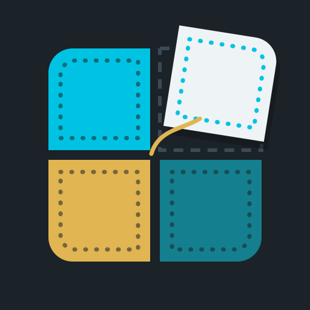

<p align="center"></p>

# Patchwork

A mod manager that runs on your modded Switch. Browse mods for *The Legend of Zelda: Breath of the Wild*
and *Tears of the Kingdom* on [GameBanana](https://gamebanana.com), then download, install, turn on/off,
reorder and remove them, all from the console.

Patchwork is an unofficial fan project. It isn't affiliated with or endorsed by Nintendo or GameBanana.
Mods belong to their authors.

## Features

- **Browse and search** GameBanana with a live preview of each mod
- **Waikuteru's mods** ([waikuteru-zelda-mods.com](https://www.waikuteru-zelda-mods.com)) as a second source in Browse (L/R); only Switch versions are offered
- **Add mods from anywhere**: copy archives into `switch/patchwork/inbox` on the SD card, send a link from your phone (open the address/QR code the Switch shows, paste a link), or type a GameBanana mod number (the end of its link, e.g. `724536`) in Add mods or Search
- **Picks the right file** for your installed game version and warns about mismatches
- **One-press install** from zip, 7z and rar, including archives with several options or nested archives
- **On/off without deleting**: a clean copy of every mod is kept, so turning one off restores the files underneath
- **Load order**: when two mods change the same file, the one higher in the list wins, and Patchwork tells you which files clash
- **Keeps your own files safe**: anything already in `atmosphere/contents` is backed up before a mod overwrites it and restored afterwards
- **Save files** from GameBanana (100% saves, unlocked shrines…): pick the save, the user profile and the slot. Patchwork backs up that profile's whole save to `switch/patchwork/save-backups` first, and Settings → Save backups puts it back. A save's photo album is only copied if you turn that on.
- **Hides NSFW mods** (uses GameBanana's own content ratings), including mods opened by link or number. The setting is kept out of sight for kids: hold **L + R + −** for 3 seconds on the Settings page to show it. It turns back on every time Patchwork starts.

Patchwork copies files into Atmosphère's LayeredFS folders. It doesn't merge mods' changes into the game's
own files, with one exception: BOTW's resource size table, which it merges from the game's copy (read when
Patchwork is opened by holding R while starting BOTW) and every enabled mod. That makes BCML packages (`.bnp`)
that only list resource sizes installable. BCML packages that need real merging, and TKMM (`.tkcl`) packages,
are hidden from Browse and flagged as needing those PC tools.

## Install

1. Download `patchwork.nro` from the releases page.
2. Copy it to `sd:/switch/patchwork/patchwork.nro`.
3. Launch it from the Homebrew Menu. For the most memory, open the Homebrew Menu by holding **R** while starting a game.

Requires Atmosphère and an internet connection. Mods are stored in `sd:/switch/patchwork/`.

## Controls

| Button | Browse | My mods |
|---|---|---|
| A | Install | Turn on / off |
| Y | Change sort | |
| X | Search | Remove |
| L / R | | Move up / down in load order |
| L / R | GameBanana / Waikuteru | |
| ZL / ZR | Switch game | Switch game |
| + | Quit | Quit |

## Building

Requires [devkitPro](https://devkitpro.org/wiki/Getting_Started) with `switch-dev` and `switch-portlibs`.

```bash
git clone --recursive https://github.com/<you>/patchwork-nx
cd patchwork-nx
export DEVKITPRO=/opt/devkitpro
cmake -S . -B build-switch -DPLATFORM_SWITCH=ON -DCMAKE_BUILD_TYPE=Release
cmake --build build-switch --target patchwork.nro
```

Desktop build for UI development (macOS/Linux, needs `libarchive` and `curl`):

```bash
cmake -S . -B build-desktop -DPLATFORM_DESKTOP=ON
cmake --build build-desktop
cd build-desktop && MM_SD_ROOT=/tmp/fake-sd MM_TOTK_VERSION=1.2.1 ./patchwork
```

Core logic tests (no UI); see [docs/TESTING.md](docs/TESTING.md) for the full test plan:

```bash
cmake -S . -B build && cmake --build build && ./build/mmtests
```

## Layout

- `source/core/`: portable logic: GameBanana API, archive extraction, layout detection, install/enable/priority engine
- `source/app/`: the Borealis UI
- `tools/mmcli.cpp`: desktop command-line driver for the core
- `tests/`: unit tests

Built with [Borealis](https://github.com/xfangfang/borealis), libcurl, libarchive and nlohmann/json.
